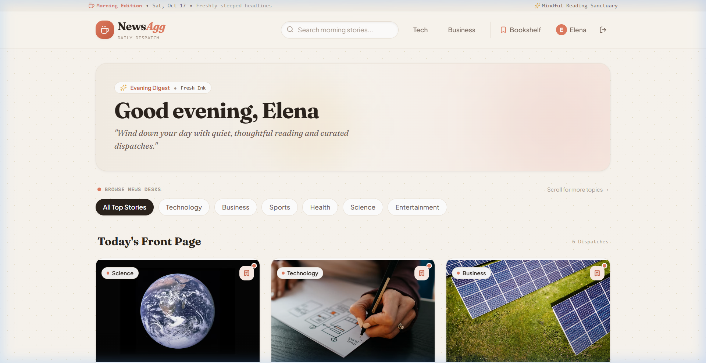
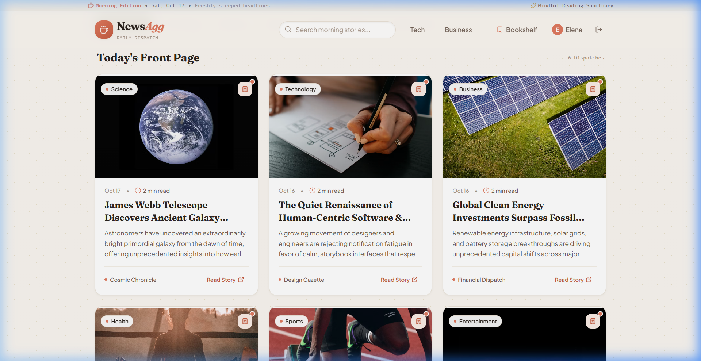
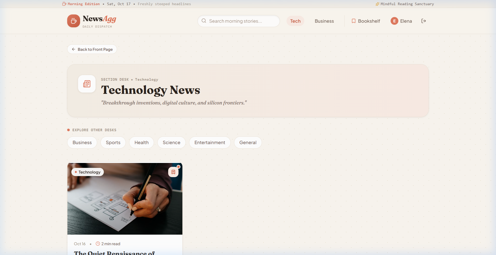
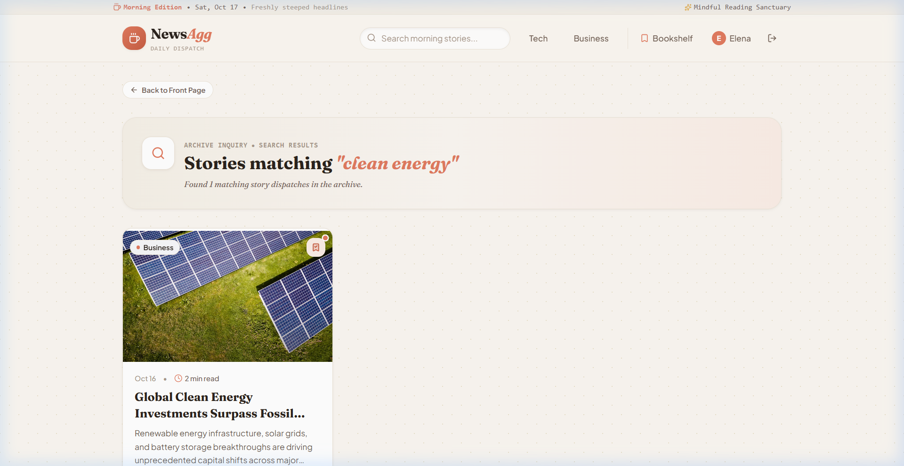
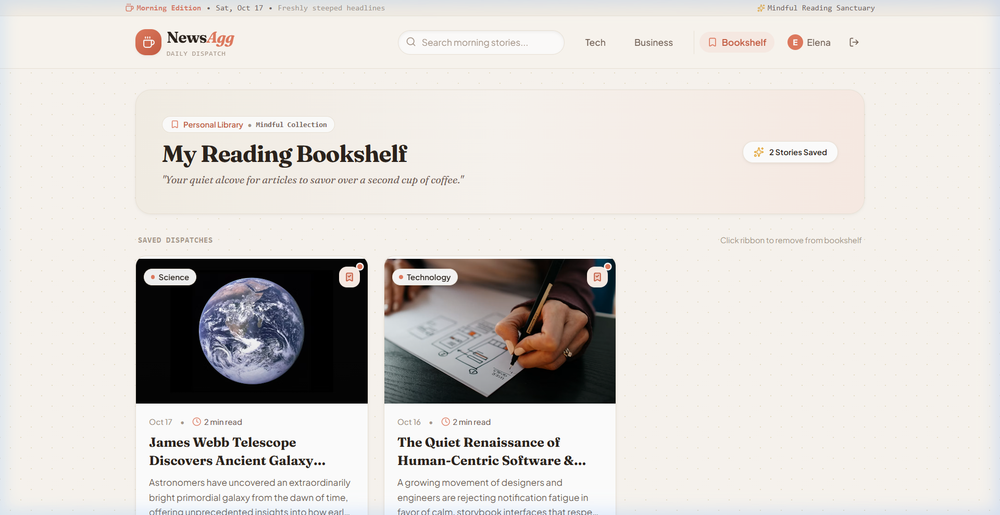
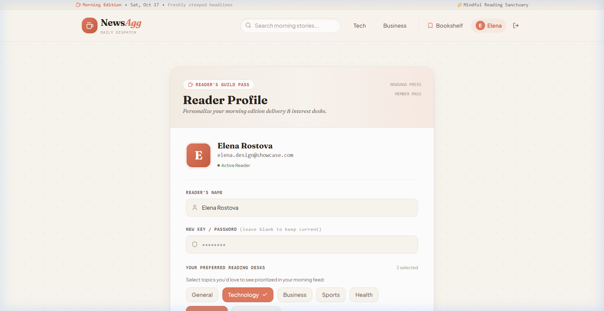
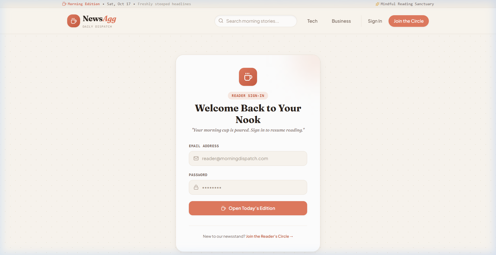
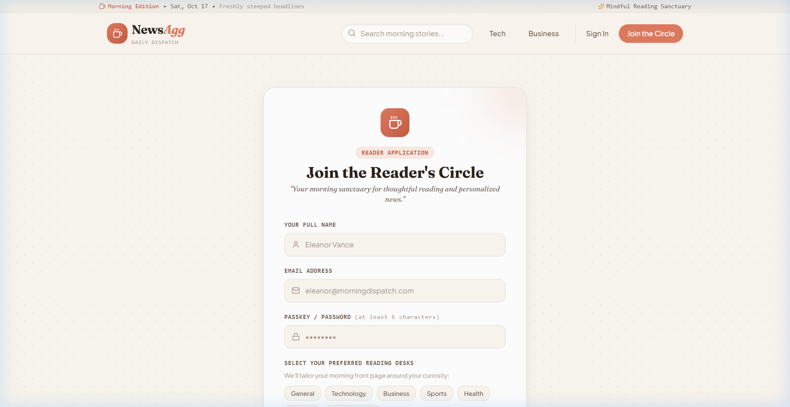

# News Aggregator

A complete, production-ready full-stack MERN web application where users can browse top headlines, search for news, filter by categories, and bookmark their favorite articles.

## Design Showcase & Visual UI/UX

> Designed with the **"Cozy Morning Edition"** design system — a mindful, storybook editorial reading sanctuary crafted for human readers. It balances warm typography, natural paper grain textures, and tactile micro-interactions without AI emoji clutter.

### 1. Front Page & Hero Masthead
*Time-aware adaptive masthead banner, quick category desk filters, and top headlines.*


### 2. Editorial Newsstand & Story Cards
*High-readability serif cards with reading time estimation, category dot stamps, and fabric ribbon bookmarks.*


### 3. Section Desks (Category Feed)
*Dedicated news desk experience with section descriptors, quick topic switching, and curated category dispatches.*


### 4. Archive Inquiry (Search Feed)
*Instant keyword search with contextual query pill, match counters, and suggested topic exploration.*


### 5. Personal Reading Bookshelf (Bookmarks)
*Curated personal library view with saved story counters and quick bookmark management.*


### 6. Reader's Guild Membership Pass (Profile)
*Collectible reader card with avatar monogram, member badge, and interactive reading desk preferences.*


### 7. Reader Sign-In & Verification
*Inviting storybook card with focused inputs, credential validation, and warm editorial feedback.*


### 8. Reader Circle Application (Registration)
*Personalized onboarding flow allowing readers to tailor their morning edition interests upon signup.*


---

## Design System Specifications

| Token | Value | Purpose |
| :--- | :--- | :--- |
| **Paper Background** | `#FAF6F0` | Warm oat-milk parchment reducing eye strain during long-form reading |
| **Roast Ink** | `#2B231D` | Deep espresso for primary headlines, offering softer contrast than harsh black |
| **Muted Cinnamon** | `#6E5D53` | Warm secondary text for article descriptions and excerpts |
| **Morning Terracotta**| `#E07A5F` | Primary accent for call-to-actions, ribbon bookmarks, and highlights |
| **Soft Parchment** | `#EBE3D7` | Gentle paper-edge borders and container dividers |
| **Display Serif** | `Fraunces` | Modern Google variable serif with optical sizing for warm editorial charm |
| **Interface Sans** | `Plus Jakarta Sans` | Clean humanist geometric sans for high-readability body text |

---

## Features
- **User Authentication**: Secure registration and login using JWT and bcrypt.
- **News Browsing**: Fetch top headlines from NewsAPI, with a seamless local JSON fallback if the API key is absent or exhausted.
- **Search & Categories**: Search functionality by keyword and browsing by categories (Technology, Business, Sports, etc.).
- **Bookmarking**: Users can save articles to their personal bookmarks and remove them later.
- **Profile Management**: Update user profile details and preferred categories.
- **Editorial Responsive UI**: Tailored with React, Tailwind CSS, and custom tactile micro-interactions.

## Tech Stack
- **Frontend**: React (Vite), React Router DOM, Axios, Tailwind CSS.
- **Backend**: Node.js, Express.js, MongoDB Atlas (Mongoose), JWT, bcrypt, Express Validator, Helmet, CORS.

## Project Structure
```
news_agg/
├── client/          # Frontend React App (Vite)
│   ├── public/
│   ├── src/
│   │   ├── components/
│   │   ├── context/
│   │   ├── pages/
│   │   ├── services/
│   │   ├── App.jsx
│   │   └── main.jsx
│   └── tailwind.config.js
└── server/          # Backend Express API
    ├── config/
    ├── controllers/
    ├── data/        # Fallback JSON dataset
    ├── middleware/
    ├── models/
    ├── routes/
    ├── utils/
    └── server.js
```

## Getting Started

### Prerequisites
- Node.js (v18+)
- MongoDB Atlas Account (or local MongoDB)
- NewsAPI Key (Optional, get one at [newsapi.org](https://newsapi.org/). Application falls back to local data without it).

### Backend Setup
1. Navigate to the server directory:
   ```bash
   cd server
   ```
2. Install dependencies:
   ```bash
   npm install
   ```
3. Create a `.env` file based on `.env.example`:
   ```env
   PORT=5000
   MONGODB_URI=your_mongodb_connection_string
   JWT_SECRET=your_super_secret_key
   NEWS_API_KEY=your_news_api_key (optional)
   FRONTEND_URL=http://localhost:5173
   NODE_ENV=development
   ```
4. Start the backend development server:
   ```bash
   npm start
   # or node server.js
   ```

### Frontend Setup
1. Navigate to the client directory:
   ```bash
   cd client
   ```
2. Install dependencies:
   ```bash
   npm install
   ```
3. Create a `.env` file based on `.env.example`:
   ```env
   VITE_API_URL=http://localhost:5000/api
   ```
4. Start the frontend development server:
   ```bash
   npm run dev
   ```

## API Endpoints

### Auth
- `POST /api/auth/register` - Register a new user
- `POST /api/auth/login` - Login user
- `GET /api/auth/me` - Get current logged in user (Protected)

### User Profile
- `GET /api/profile` - Get user profile (Protected)
- `PUT /api/profile` - Update user profile (Protected)

### News
- `GET /api/news` - Get latest top headlines
- `GET /api/news/category/:category` - Get news by category
- `GET /api/news/search?q=keyword` - Search news

### Bookmarks
- `GET /api/bookmarks` - Get user's bookmarked articles (Protected)
- `POST /api/bookmarks` - Bookmark an article (Protected)
- `DELETE /api/bookmarks/:id` - Remove a bookmark (Protected)

## Deployment Instructions

### Deploying Backend to Render
1. Push the `server` folder (or the whole repo and specify the root directory as `server`) to GitHub.
2. In Render, create a new "Web Service".
3. Connect your repository.
4. Set Build Command: `npm install`
5. Set Start Command: `node server.js`
6. Add the Environment Variables (`MONGODB_URI`, `JWT_SECRET`, `NEWS_API_KEY`, etc.).

### Deploying Frontend to Vercel
1. Push the `client` folder to GitHub.
2. In Vercel, create a new Project.
3. Import your repository, and set the Root Directory to `client`.
4. The framework preset should automatically detect Vite.
5. Add the Environment Variable `VITE_API_URL` pointing to your deployed backend URL (e.g., `https://your-backend.onrender.com/api`).
6. Deploy.

## Future Improvements
- Pagination for news feed and bookmarks.
- Dark mode toggle.
- Advanced personalized feed based on user activity.
- Share article functionality.

## License
MIT License
